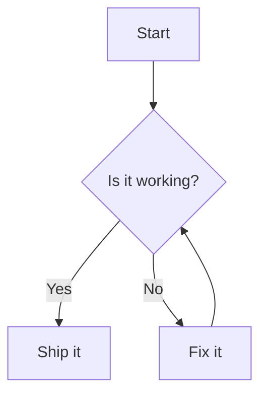

# dumi-plugin-mermaid

> 把 `mermaid` 代码块渲染成图表。

## Usage

### Install

> 前置条件：dumi@2.0.0+

```bash
npm install dumi-plugin-mermaid --save-dev
# yarn add dumi-plugin-mermaid --dev
# pnpm add dumi-plugin-mermaid --save-dev
# bun add dumi-plugin-mermaid --dev
```

### Apply

```ts
// .dumirc.ts
export default {
  plugins: ['dumi-plugin-mermaid'],
};
```

### Example

<pre lang="markdown">

</pre>

### Options

`mermaidConfig` 会作为 `mermaid.initialize` 的参数，必须是可序列化的 JSON。
选项写在**与插件同名的顶层配置键**下（umi 4 已不支持 `plugins: [['plugin', options]]` 写法）：

```ts
// .dumirc.ts
export default {
  plugins: ['dumi-plugin-mermaid'],
  'dumi-plugin-mermaid': {
    mermaidConfig: { securityLevel: 'loose' },
  },
};
```

控件的多语言文案同样可以在这里用 `locales` 覆盖（跟随 dumi 当前语言，内置 `zh-CN` / `en-US`）：

```ts
// .dumirc.ts
export default {
  plugins: ['dumi-plugin-mermaid'],
  'dumi-plugin-mermaid': {
    locales: { 'zh-CN': { 'mermaid.actions.expand': '全屏查看' } },
  },
};
```

### Full Document

Read more: https://wxh16144.github.io/dumi-plugin-mermaid/
