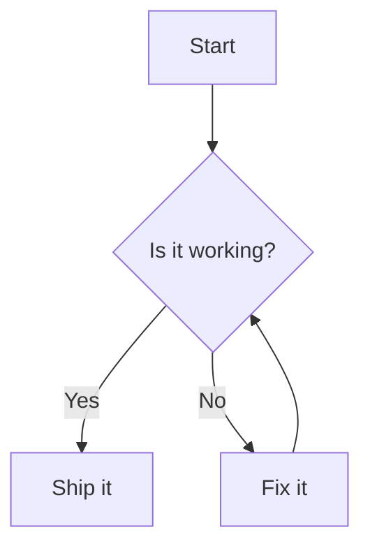

# dumi-plugin-mermaid

> 把 `mermaid` 代码块渲染成图表，并为 dumi 站点补上放大、复制与平移缩放等交互。

## 特性

| 能力     | 说明                                                                 |
| -------- | -------------------------------------------------------------------- |
| 代码块   | 用 `mermaid` 代码块书写图表，构建期自动替换成内置组件                |
| 主题     | 跟随 dumi 明暗配色，切换时自动重新渲染                               |
| 控件     | 右上角放大 / 复制源码 / 复制 PNG，右下角平移缩放面板                 |
| 交互     | 鼠标拖拽平移，`Ctrl` / `Cmd` + 滚轮缩放（范围 `0.25x` ~ `4x`）       |
| 多语言   | 控件文案跟随 dumi 当前语言，内置 `zh-CN` / `en-US`，可覆盖或新增     |
| 可自定义 | 用 theme builtin 接管渲染，或用 `dumi-plugin-mermaid/component` 组合 |

## 使用

### 安装

> 前置条件：dumi@2.0.0+

```bash
npm install dumi-plugin-mermaid --save-dev
# yarn add dumi-plugin-mermaid --dev
# pnpm add dumi-plugin-mermaid --save-dev
# bun add dumi-plugin-mermaid --dev
```

### 启用

```ts
// .dumirc.ts
export default {
  plugins: ['dumi-plugin-mermaid'],
};
```

### 示例

<pre lang="markdown">

</pre>

## 控件与交互

图表区叠了两组悬浮控件，默认全开：

| 位置 | 控件              | 行为                                                            |
| ---- | ----------------- | --------------------------------------------------------------- |
| 右上 | 放大              | 在弹窗里放大展示，支持 `Esc` / 点击遮罩关闭，关闭后焦点回到按钮 |
| 右上 | 复制 Mermaid 源码 | 把源码写入剪贴板，可直接粘到 mermaid.live 或 Markdown 代码块里  |
| 右上 | 复制 PNG          | 导出 2 倍分辨率 PNG 写入剪贴板                                  |
| 右下 | `↑` `↓` `←` `→`   | 平移图表内容                                                    |
| 右下 | 放大 / 缩小       | 以容器中心为不动点缩放，范围 `0.25x` ~ `4x`                     |
| 右下 | 复位              | 回到初始视图                                                    |

- **鼠标**：拖拽可平移；`Ctrl` / `Cmd` + 滚轮可缩放。普通滚轮不拦截，页面照常滚动。
- **触屏**：不接管拖拽手势，避免抢走页面纵向滚动，请用右下角的按钮操作。
- 复制走的是 `navigator.clipboard`，要求 `https` 或 `localhost`；不可用时（非安全上下文、
  无权限、浏览器不支持写图片）会自动降级为下载文件（源码存为 `.mmd`、图片存为 `.png`），
  提示也会换成「已下载」。

两组控件可以分别关掉：

```tsx
import { MermaidViewer } from 'dumi-plugin-mermaid/component';

export default () => <MermaidViewer code="graph TD; A --> B;" toolbar={false} panZoom={false} />;
```

`MermaidToggle`（默认导出）同样接受 `toolbar` / `panZoom`，会透传给图表区。

## 配置

插件配置写在**与插件同名的顶层配置键** `'dumi-plugin-mermaid'` 下（umi 4 已不再支持
`plugins: [['plugin', options]]` 的元组写法）：

```ts
// .dumirc.ts
export default {
  plugins: ['dumi-plugin-mermaid'],
  'dumi-plugin-mermaid': {
    mermaidConfig: { securityLevel: 'loose' },
  },
};
```

| 选项            | 类型                                  | 说明                                                                          |
| --------------- | ------------------------------------- | ----------------------------------------------------------------------------- |
| `mermaidConfig` | `object`                              | 透传给 `mermaid.initialize`，例如 `theme`、`securityLevel`，需可序列化的 JSON |
| `locales`       | `Record<locale, Record<key, string>>` | 覆盖控件文案，只写想改的 key，其余自动回退                                    |

控件文案会跟随 dumi 当前语言自动切换，内置 `zh-CN` / `en-US`：

```ts
// .dumirc.ts
export default {
  plugins: ['dumi-plugin-mermaid'],
  'dumi-plugin-mermaid': {
    locales: {
      'zh-CN': { 'mermaid.actions.expand': '全屏查看' },
      'ja-JP': { 'mermaid.tabs.preview': 'プレビュー' },
    },
  },
};
```

写了不在 schema 里的选项名（例如把 `mermaidConfig` 拼错）会在启动时直接报错，而不是静默失效。
词条 key 全表、取值优先级、以及 `.dumi/theme/locales/*.json` 的覆盖方式见
[使用文档](https://wxh16144.github.io/dumi-plugin-mermaid/usage)。

## 组件

`dumi-plugin-mermaid/component` 导出以下组件和 Hook：

| 导出            | 说明                                                        |
| --------------- | ----------------------------------------------------------- |
| `default`       | 右上角带「预览 / 源码」切换的图表，等同于 `MermaidToggle`   |
| `Mermaid`       | 只渲染图表，不带任何控件                                    |
| `MermaidViewer` | 带放大 / 复制 / 平移缩放控件的图表                          |
| `MermaidSource` | 只渲染 Mermaid 源码                                         |
| `MermaidToggle` | 等同于默认导出，preview 一侧用的就是 `MermaidViewer`        |
| `useMermaid`    | 渲染源码并返回 `{ svg, error, loading }`，用于组合自定义 UI |

`svg` 是经过 XML 序列化、可独立使用的 SVG 字符串。需要生成下载链接、图片预览等内容时，用 `onRender` 拿：

```tsx
import { MermaidToggle } from 'dumi-plugin-mermaid/component';

export default () => (
  <MermaidToggle
    code="graph TD; A --> B;"
    onRender={(svg) => {
      console.log(svg);
    }}
  />
);
```

想接管 `mermaid` 代码块的渲染，在站点里给出同名 builtin 即可：

```tsx
// .dumi/theme/builtins/DumiPluginMermaid/index.tsx
export { Mermaid as default } from 'dumi-plugin-mermaid/component';
```

## 样式

所有样式都包在 `:where()` 里（特异性为 0），站内 CSS 可以直接覆盖：

- 图表本体：`.dumi-plugin-mermaid`，`padding: 16px`、最小高度 `240px`，图表默认居中。
- 控件：`.dumi-plugin-mermaid-viewer` 下的 `--mermaid-control-size`、`--mermaid-radius`、
  `--mermaid-surface`、`--mermaid-surface-hover` 等变量，以及 `.dumi-plugin-mermaid-viewer-*` 类名。
- 弹窗：`.dumi-plugin-mermaid-modal` 下的 `--mermaid-panel-bg`、`--mermaid-panel-fg`、
  `--mermaid-panel-border`（按明暗主题各给一套默认值）。
- 预览 / 源码切换：`.dumi-plugin-mermaid-toggle` 下的 `--line`、`--bg`、`--active-bg`；
  标签为 `.dumi-plugin-mermaid-toggle-tab`，选中态是 `[aria-pressed='true']`。

## 限制

- 仅支持运行时渲染，因此 `rehype-mermaid` 的以下选项不可用：`strategy`（`img-png` / `img-svg` /
  `inline-svg`）、`dark`、`colorScheme`、`errorFallback`、`screenshot`、`browser`、`launchOptions`。
- 写在 `::: code-group` 里的图表会就地渲染，可能与 tab 布局不符。
- PNG 导出依赖 canvas，图表内引用**跨域**字体或图片时浏览器会拒绝导出，此时会降级为下载 SVG。

## 更多文档

Read more: https://wxh16144.github.io/dumi-plugin-mermaid/
