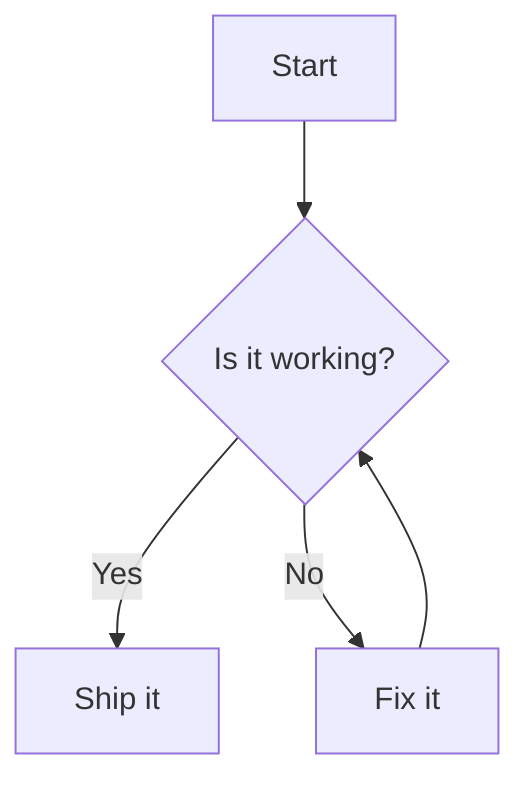

## 安装

> 前置条件：dumi@2.0.0+

:::code-group

```bash [npm]
npm install dumi-plugin-mermaid --save-dev
```

```bash [yarn]
yarn add dumi-plugin-mermaid --dev
```

```bash [pnpm]
pnpm add dumi-plugin-mermaid --save-dev
```

```bash [bun]
bun add dumi-plugin-mermaid --dev
```

:::

<br />

## 使用

```js {3} | pure
// .dumirc.ts
export default {
  plugins: ['dumi-plugin-mermaid'],
};
```

然后在 Markdown 里用 `mermaid` 代码块书写图表：

<pre lang="markdown">

</pre>

## 配置

插件配置写在**与插件同名的顶层配置键** `'dumi-plugin-mermaid'` 下（umi 4 已不再支持
`plugins: [['plugin', options]]` 的元组写法），其中 `mermaidConfig` 会作为
`mermaid.initialize` 的参数，**必须是可序列化的 JSON**：

```js {3-5} | pure
// .dumirc.ts
export default {
  plugins: ['dumi-plugin-mermaid'],
  'dumi-plugin-mermaid': {
    mermaidConfig: { securityLevel: 'loose' },
  },
};
```

未配置时会补默认值 `{}`；写了不在 schema 里的选项名（例如把 `mermaidConfig` 拼错）会
在启动时直接报错，而不是静默失效：

```text
Invalid value for dumi-plugin-mermaid:
"mermaidConfg" is not allowed
```

可配的选项：

| 选项            | 类型                                  | 说明                                                       |
| --------------- | ------------------------------------- | ---------------------------------------------------------- |
| `mermaidConfig` | `object`                              | 透传给 `mermaid.initialize`，例如 `theme`、`securityLevel` |
| `locales`       | `Record<locale, Record<key, string>>` | 覆盖控件文案，见 [多语言](#多语言)                         |

### 自定义

<i>Source Code: [src/component](https://github.com/Wxh16144/dumi-plugin-mermaid/tree/master/src/component)</i>

在 `.dumi/theme/builtins/DumiPluginMermaid/index.tsx` 里给出一份自己的实现，即可接管渲染：

```js | pure
// .dumi/theme/builtins/DumiPluginMermaid/index.tsx
export default (props) => {
  return <div>{props.code}</div>;
};
```

#### 切换源码与图表

`dumi-plugin-mermaid/component` 导出以下组件和 Hook：

| 导出            | 说明                                                                 |
| --------------- | -------------------------------------------------------------------- |
| `default`       | 右上角带切换按钮的图表（等同于 `MermaidToggle`）                     |
| `Mermaid`       | 只渲染图表，不带任何控件                                             |
| `MermaidViewer` | 带放大 / 复制 / 平移缩放控件的图表                                   |
| `MermaidSource` | 只渲染 Mermaid 源码                                                  |
| `MermaidToggle` | 等同于默认导出，preview 一侧用的就是 `MermaidViewer`                 |
| `useMermaid`    | 渲染 Mermaid 源码并返回 `{ svg, error, loading }`，用于组合自定义 UI |

`Mermaid` 与 `MermaidToggle` 接受 `code`、`mermaidConfig` 和可选的 `onRender(svg)`。其中 `svg` 是经过 XML 序列化、可独立使用的 SVG 字符串。需要在图表渲染完成后生成下载链接、图片预览等内容时，可以使用 `onRender`：

```tsx | pure
import { MermaidToggle } from 'dumi-plugin-mermaid/component';

export default () => (
  <MermaidToggle
    code="graph TD; A --> B;"
    onRender={(svg) => {
      console.log(svg);
    }}
  />
);
```

默认导出的组件会渲染图表，点击右上角按钮即可查看源码。想只渲染图表、不带切换按钮时：

```js | pure
// .dumi/theme/builtins/DumiPluginMermaid/index.tsx
export { Mermaid as default } from 'dumi-plugin-mermaid/component';
```

#### 图表控件

`MermaidViewer`（也就是默认导出里的图表区）在图区上叠了两组悬浮控件：

| 位置 | 控件              | 行为                                                                          |
| ---- | ----------------- | ----------------------------------------------------------------------------- |
| 右上 | 放大              | 在弹窗里放大展示图表，支持 Esc / 点击遮罩关闭，关闭后焦点回到按钮             |
| 右上 | 复制 Mermaid 源码 | 把图表的 mermaid 源码写入剪贴板，可直接粘到 mermaid.live 或 Markdown 代码块里 |
| 右上 | 复制 PNG          | 导出 2 倍分辨率 PNG 图片写入剪贴板                                            |
| 右下 | `↑` `↓` `←` `→`   | 平移图表内容                                                                  |
| 右下 | 放大 / 缩小       | 以容器中心为不动点缩放，范围 `0.25x` ~ `4x`                                   |
| 右下 | 复位              | 回到初始视图                                                                  |

- **鼠标**：拖拽可平移；`Ctrl` / `Cmd` + 滚轮可缩放。普通滚轮不拦截，页面照常滚动。
- **触屏**：不接管拖拽手势，避免抢走页面纵向滚动，请用右下角的按钮操作。
- 只监听 `Ctrl` / `Cmd` + 滚轮是为了**不劫持文档滚动**，这也是在长文档里使用这类控件的前提。
- 复制走的是 `navigator.clipboard`，要求 `https` 或 `localhost`；若剪贴板不可用（非安全上下文、
  无权限、浏览器不支持写图片），会自动降级为下载文件（源码存为 `.mmd`、图片存为 `.png`），
  并把提示换成「已下载」。

两组控件都可以关掉：

```tsx | pure
import { MermaidViewer } from 'dumi-plugin-mermaid/component';

export default () => <MermaidViewer code="graph TD; A --> B;" toolbar={false} panZoom={false} />;
```

`MermaidToggle` 同样接受 `toolbar` / `panZoom`，会透传给图表区。

### 多语言

控件文案（标签页、按钮的无障碍名称、复制结果提示）会**跟随 dumi 当前语言**自动切换，
内置 `zh-CN` 与 `en-US` 两套词条，站点在 `.dumirc.ts` 配好 `locales` 即可生效，无需额外配置。

> 为什么插件要自带词表？dumi 的 i18n `messages` 只从**主题**的 `themeData.locales`
> （主题目录下的 `locales/*.json`）收集，普通插件没有官方注入点。所以这里只借用 dumi 的
> locale 上下文来选词表，不依赖任何未公开 API。

#### 改词 / 新增语言

**方式一：插件 `locales` 选项**（改动最少，推荐）。在 `.dumirc.ts` 里按语言给出要替换的词条，
**只写想改的 key 就行**，其余自动回退：

```ts
// .dumirc.ts
export default {
  plugins: ['dumi-plugin-mermaid'],
  'dumi-plugin-mermaid': {
    locales: {
      'zh-CN': { 'mermaid.actions.expand': '全屏查看' },
      'ja-JP': { 'mermaid.tabs.preview': 'プレビュー' },
    },
  },
};
```

**方式二：站点词表 `.dumi/theme/locales/<locale>.json`**。dumi 会把它合并进 i18n `messages`，
插件也会采用，适合想让整个站点的 i18n 字典里就有 `mermaid.*` 的场景（例如自定义主题）。**只写想改的 key 就行**：

```json
// .dumi/theme/locales/zh-CN.json
{
  "mermaid.actions.expand": "全屏查看",
  "mermaid.feedback.copied": "已拷贝"
}
```

要新增插件未内置的语言（例如日语），先在 `.dumirc.ts` 声明 locale，再补一份词表即可：

```ts
// .dumirc.ts
export default {
  locales: [{ id: 'ja-JP', name: '日本語' }],
};
```

```json
// .dumi/theme/locales/ja-JP.json（用方式一也可以）
{
  "mermaid.tabs.preview": "プレビュー",
  "mermaid.actions.expand": "拡大表示",
  "mermaid.feedback.copied": "コピーしました"
}
```

> 新语言只翻译一部分 key 时，未翻译的 key 会走内置兜底（即英文），不会退回站点的默认语言；
> 想完全本地化就补齐上表所有 key。

#### 词条 key 一览

| key                           | en-US             | zh-CN             |
| ----------------------------- | ----------------- | ----------------- |
| `mermaid.tabs.label`          | View              | 视图              |
| `mermaid.tabs.preview`        | Preview           | 预览              |
| `mermaid.tabs.code`           | Code              | 源码              |
| `mermaid.actions.label`       | Diagram actions   | 图表操作          |
| `mermaid.actions.expand`      | Expand            | 放大              |
| `mermaid.actions.copy.source` | Copy Mermaid code | 复制 Mermaid 源码 |
| `mermaid.actions.copy.image`  | Copy PNG image    | 复制 PNG 图片     |
| `mermaid.dialog.label`        | Mermaid diagram   | Mermaid 图表      |
| `mermaid.dialog.close`        | Close             | 关闭              |
| `mermaid.panzoom.label`       | Pan and zoom      | 平移缩放          |
| `mermaid.panzoom.up`          | Pan up            | 上移              |
| `mermaid.panzoom.down`        | Pan down          | 下移              |
| `mermaid.panzoom.left`        | Pan left          | 左移              |
| `mermaid.panzoom.right`       | Pan right         | 右移              |
| `mermaid.panzoom.in`          | Zoom in           | 放大              |
| `mermaid.panzoom.out`         | Zoom out          | 缩小              |
| `mermaid.panzoom.reset`       | Reset view        | 重置视图          |
| `mermaid.feedback.copied`     | Copied!           | 已复制            |
| `mermaid.feedback.downloaded` | Downloaded        | 已下载            |

#### 取值优先级

同一个 key 在多个来源都出现时，从高到低取值：

1. 插件 `locales` 选项 —— 站点**显式配置**，最具体
2. `.dumi/theme/locales/*.json` 等宿主 i18n `messages` 里的同名词条
3. 插件内置词表中**当前语言**的词条
4. 同语言兜底（`zh-TW` → `zh-CN`）
5. `en-US` 兜底（保证任何 key 都不会渲染成空）

> 之所以让选项排在宿主词条之前：宿主词条可能来自**第三方主题包**，
> 站点自己在 `.dumirc.ts` 里写的配置不应该被依赖项的默认值悄悄盖掉。

#### 组件级覆盖

用自定义主题 builtin 接管渲染时，也可以直接给 `MermaidViewer` 传 `locales`（同样是上面第 1 级）：

```tsx | pure
import { MermaidViewer } from 'dumi-plugin-mermaid/component';

export default () => (
  <MermaidViewer
    code="graph TD; A --> B;"
    locales={{
      'en-US': { 'mermaid.actions.expand': 'Fullscreen' },
      'ja-JP': { 'mermaid.tabs.preview': 'プレビュー' },
    }}
  />
);
```

其中语言 key 与 dumi 的 locale id 一致。

## 限制

仅支持运行时渲染，因此 `rehype-mermaid` 的以下选项不可用：`strategy`（`img-png` / `img-svg` / `inline-svg`）、
`dark`、`colorScheme`、`errorFallback`、`screenshot`、`browser`、`launchOptions`。写在 `::: code-group` 里的图表
会就地渲染，可能与 tab 布局不符。

PNG 导出依赖 canvas，图表内引用**跨域**字体或图片时浏览器会拒绝导出，此时会降级为下载 SVG。
