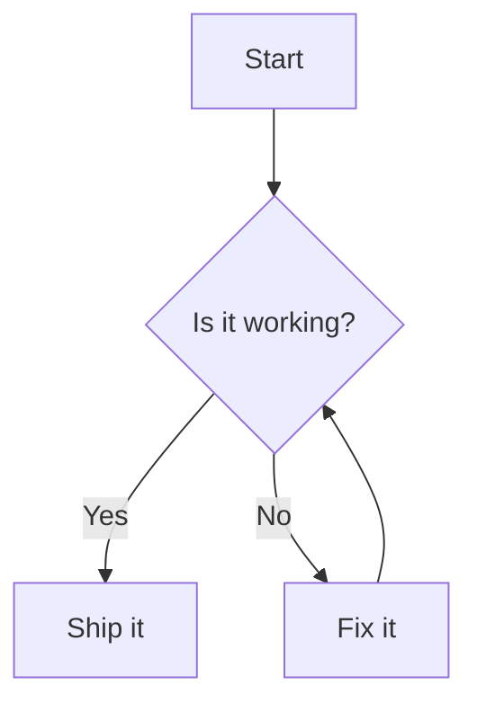

## 安装

> 前置条件：dumi@2.0.0+

:::code-group

```bash [npm]
npm install dumi-plugin-mermaid --save-dev
```

```bash [yarn]
yarn add dumi-plugin-mermaid --dev
```

```bash [pnpm]
pnpm add dumi-plugin-mermaid --save-dev
```

```bash [bun]
bun add dumi-plugin-mermaid --dev
```

:::

<br />

## 使用

```js {3} | pure
// .dumirc.ts
export default {
  plugins: ['dumi-plugin-mermaid'],
};
```

然后在 Markdown 里用 `mermaid` 代码块书写图表：

<pre lang="markdown">

</pre>

## 配置

插件选项会作为 `mermaid.initialize` 的参数，**必须是可序列化的 JSON**。

```js {6-8} | pure
// .dumirc.ts
export default {
  plugins: [
    [
      'dumi-plugin-mermaid',
      {
        mermaidConfig: { securityLevel: 'loose' },
      },
    ],
  ],
};
```

### 自定义

<i>Source Code: [src/component](https://github.com/Wxh16144/dumi-plugin-mermaid/tree/master/src/component)</i>

在 `.dumi/theme/builtins/DumiPluginMermaid/index.tsx` 里给出一份自己的实现，即可接管渲染：

```js | pure
// .dumi/theme/builtins/DumiPluginMermaid/index.tsx
export default (props) => {
  return <div>{props.code}</div>;
};
```

#### 切换源码与图表

`dumi-plugin-mermaid/component` 导出以下组件和 Hook：

| 导出            | 说明                                                                 |
| --------------- | -------------------------------------------------------------------- |
| `default`       | 右上角带切换按钮的图表（等同于 `MermaidToggle`）                     |
| `Mermaid`       | 只渲染图表，不带任何控件                                             |
| `MermaidViewer` | 带放大 / 复制 / 平移缩放控件的图表                                   |
| `MermaidSource` | 只渲染 Mermaid 源码                                                  |
| `MermaidToggle` | 等同于默认导出，preview 一侧用的就是 `MermaidViewer`                 |
| `useMermaid`    | 渲染 Mermaid 源码并返回 `{ svg, error, loading }`，用于组合自定义 UI |

`Mermaid` 与 `MermaidToggle` 接受 `code`、`mermaidConfig` 和可选的 `onRender(svg)`。其中 `svg` 是经过 XML 序列化、可独立使用的 SVG 字符串。需要在图表渲染完成后生成下载链接、图片预览等内容时，可以使用 `onRender`：

```tsx | pure
import { MermaidToggle } from 'dumi-plugin-mermaid/component';

export default () => (
  <MermaidToggle
    code="graph TD; A --> B;"
    onRender={(svg) => {
      console.log(svg);
    }}
  />
);
```

默认导出的组件会渲染图表，点击右上角按钮即可查看源码。想只渲染图表、不带切换按钮时：

```js | pure
// .dumi/theme/builtins/DumiPluginMermaid/index.tsx
export { Mermaid as default } from 'dumi-plugin-mermaid/component';
```

#### 图表控件

`MermaidViewer`（也就是默认导出里的图表区）在图区上叠了两组悬浮控件：

| 位置 | 控件              | 行为                                                                          |
| ---- | ----------------- | ----------------------------------------------------------------------------- |
| 右上 | 放大              | 在弹窗里放大展示图表，支持 Esc / 点击遮罩关闭，关闭后焦点回到按钮             |
| 右上 | 复制 Mermaid 源码 | 把图表的 mermaid 源码写入剪贴板，可直接粘到 mermaid.live 或 Markdown 代码块里 |
| 右上 | 复制 PNG          | 导出 2 倍分辨率 PNG 图片写入剪贴板                                            |
| 右下 | `↑` `↓` `←` `→`   | 平移图表内容                                                                  |
| 右下 | 放大 / 缩小       | 以容器中心为不动点缩放，范围 `0.25x` ~ `4x`                                   |
| 右下 | 复位              | 回到初始视图                                                                  |

- **鼠标**：拖拽可平移；`Ctrl` / `Cmd` + 滚轮可缩放。普通滚轮不拦截，页面照常滚动。
- **触屏**：不接管拖拽手势，避免抢走页面纵向滚动，请用右下角的按钮操作。
- 只监听 `Ctrl` / `Cmd` + 滚轮是为了**不劫持文档滚动**，这也是在长文档里使用这类控件的前提。
- 复制走的是 `navigator.clipboard`，要求 `https` 或 `localhost`；若剪贴板不可用（非安全上下文、
  无权限、浏览器不支持写图片），会自动降级为下载文件（源码存为 `.mmd`、图片存为 `.png`），
  并把提示文案换成 `Downloaded`。

两组控件都可以关掉：

```tsx | pure
import { MermaidViewer } from 'dumi-plugin-mermaid/component';

export default () => <MermaidViewer code="graph TD; A --> B;" toolbar={false} panZoom={false} />;
```

`MermaidToggle` 同样接受 `toolbar` / `panZoom`，会透传给图表区。

## 限制

仅支持运行时渲染，因此 `rehype-mermaid` 的以下选项不可用：`strategy`（`img-png` / `img-svg` / `inline-svg`）、
`dark`、`colorScheme`、`errorFallback`、`screenshot`、`browser`、`launchOptions`。写在 `::: code-group` 里的图表
会就地渲染，可能与 tab 布局不符。

PNG 导出依赖 canvas，图表内引用**跨域**字体或图片时浏览器会拒绝导出，此时会降级为下载 SVG。
